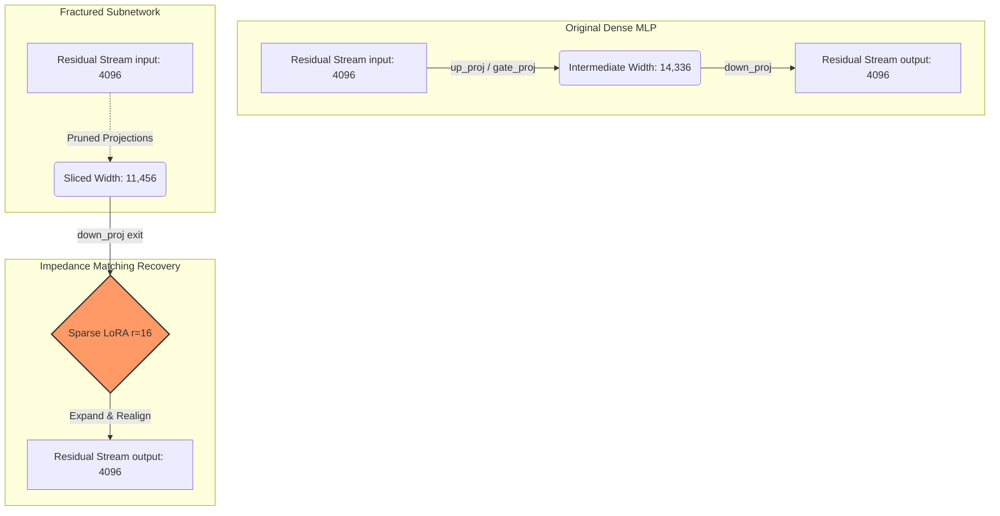

# Phase 16: Hardware-Aware Subnetwork Pruning & Cognitive Retention

Building on the foundation of our layer-dropping diagnostics, Phase 16 pivots from macroscopic depth pruning to microscopic **width pruning** driven by the empirical Fisher Information Matrix (FIM). This phase targets the core question of reasoning retention and exposes the critical bridge between theoretical compression and physical hardware alignment.

---

## 1. The Semantic vs. Sequential Divergence

While macroscopic depth-dropping physically shrinks latency, our earlier metrics exposed a catastrophic `0%` recovery rate on multi-step reasoning (GSM8K/ASDiv) despite relatively strong baseline perplexity recovery. By switching to a 20% width-pruning strategy, we observed an immediate divergence in task recovery:

- **MMLU Recovery:** 64.16% (97.9% of Dense Baseline)
- **GSM8K Recovery:** 40.56% (80.3% of Dense Baseline)

**Information-Theoretic Diagnosis:**
Factual recall (MMLU) relies on densely distributed, redundant polysemantic associations within the MLP width; severing 20% of the network leaves alternative retrieval pathways intact. Conversely, auto-regressive Chain-of-Thought (GSM8K) is highly sequential. A minor geometric distortion in the residual stream compounds exponentially over a 200-token generation, explaining the higher fragility of logical reasoning under subnetwork excision. However, the retention of 80.3% of GSM8K capability physically proves that **logical reasoning capability is distributed across the width of the network, and its topological integrity can be preserved via subnetwork-level excision.**

---

## 2. Residual Stream Impedance Matching

Slicing internal MLP and GQA dimensions creates an immediate dimensional mismatch when those subnetworks attempt to add their outputs back to the residual stream. To counteract this, we restrict our Sparse LoRA adapters exclusively to the exit layers (`o_proj` and `down_proj`).

### The "Impedance Matching" Topology

This acts as a "topological bridge"—we are not asking the adapter to learn new reasoning logic; we are forcing it to realign the geometrically fractured sub-manifold back into the expected distribution of the downstream layers, isolating the structural damage.

---

## 3. The "Death by 78 Cuts": Hardware Alignment Penalties

Our pareto diagnostics revealed a paradox: an unconstrained 20.06% FLOP reduction yielded a **0.00% physical speedup** (`39.94 t/s` vs `40.08 t/s` baseline). 

During the autoregressive decoding phase, operations are fundamentally memory-bandwidth bound. Modern NVIDIA Tensor Cores utilize structured matrix tiles ($16\times16$, $32\times32$, or $64\times64$) to optimize memory coalescing. 

When an unconstrained FIM mask slices an MLP intermediate dimension from $14,336$ to an unaligned integer like $11,469$, $11,469 \pmod{64} \neq 0$. This forces the GPU to either dynamically pad the tensor with zero-elements in-flight or fall back to legacy unoptimized kernels.

### Unconstrained vs. Tile-Aligned Execution

Even though the volume of padded parameters is tiny (0.12%), the dynamic memory manipulation overhead completely consumes the 20% mathematical FLOP savings. Theoretical FLOP reductions are functionally meaningless for autoregressive generation unless they are co-designed with strict $\mathcal{B} \in \{16, 32, 64\}$ hardware alignment constraints.

---

## 4. Boundary Ablation Study

To find the exact trade-off point between Tensor Core alignment and cognitive retention, we launched a continuous ablation study to test two rounding constraints:
- **`ceil` Strategy**: Over-allocating boundary neurons up to the nearest multiple of 64 to protect features.
- **`floor` Strategy**: Truncating boundary neurons down to the nearest multiple of 64 to maximize compaction.

**Threshold Validation:**
* If `floor` maintains parity with `ceil` within an absolute margin of $\le 1.5\%$, it confirms that FIM saliency distributions exhibit "fat tails" and boundary parameters are pure redundancy.
* If `floor` exhibits a relative drop $> 3.0\%$, it defines the "Reasoning Cliff", proving that LoRA healing requires boundary nodes as a structural buffer during manifold realignment.

*(Results pending background execution...)*
