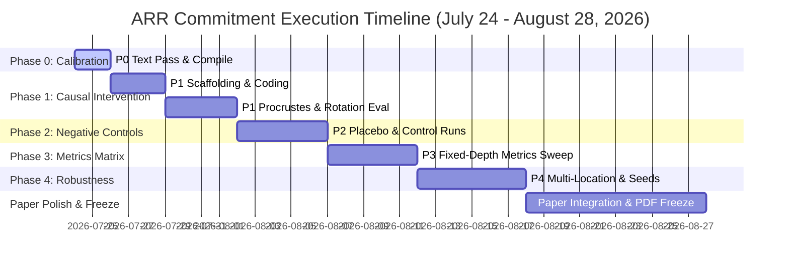

# Reviewer-Proofing Master Execution Plan: Suturing the Cut

**Master Framing**: Do NOT simply ask *"Make the paper stronger."* Ask: **"Design experiments that eliminate the strongest reviewer objections."**  
**Core Target**: ARR / BlackboxNLP 2026 Archival Commitment (**August 28, 2026** — 5-Week Horizon).  
**Immediate Action**: Priority 0 Claim Calibration in `paper/main.tex` (Today, July 24, 2026).  
**Baseline Branch**: `blackboxnlp-2026-baseline` (Commit `2401589`)  
**Active Development Branch**: `feature/subspace-suturing-improvements`  

---

## 🔍 Section 1: Situational & Paper Gap Audit

| Paper Claim / Section | TeX Line Ref | Claimed in Paper? | Code / Results Exist? | Gap & Required Action |
| :--- | :---: | :---: | :---: | :--- |
| **Claim Calibration Pass** | Lines 43–45, 220, 321 | Yes ("We prove", "causally responsible") | Partial | **P0 (Immediate)**: Soften causal claims to reflect empirical scope until P1 completes. |
| **Direct PC Realignment** | Line 220–221 | Yes | **0%** | **P1 (MVP)**: Paper asserts PC1 projection realignment, but code does not exist. Must build Procrustes & PC1 repair hooks. |
| **Orthogonal Procrustes $R = UV^T$** | Line 309 | Yes (Future outlook) | **0%** | **P1 (MVP)**: Implement $R^* = U \det(UV^T)V^T$ forward hook intervention and test GSM8K/BBH recovery. |
| **Artificial Rotation in Intact Model** | Abstract (line 43–44) | Partial | **0%** | **P1 (MVP)**: Implement $(R^*)^T$ rotation in intact model to prove rotation alone is *sufficient* to destroy reasoning. |
| **Negative Controls (Placebo / Wrong Layer)** | Section 5 (lines 267–293) | Partial (9 baselines exist) | **20%** | **P2 (Promoted)**: Add placebo random rotation, wrong-layer repair, wrong-PC repair to satisfy Reproducibility Track reviewers. |
| **Competing Scalar Metrics (Fixed Depth)** | Section 4.4 / 5.1 | Partial ($r_s=1.0$ across depth) | **40%** | **P3**: Measure Rotation vs Norm vs LayerNorm Drift vs Attention Entropy at **fixed skip-depth** ($k=4$). |
| **Pruning Location Sweeps** | Section 4 | Partial (Middle layers 11-14) | **60%** | **P4**: Run Early (3-6), Middle (11-14), Late (20-23) block drops across 3 seeds with 95% CIs. |
| **Full Spectrum Ranking ($\text{PC}_1 \dots \text{PC}_{20}$)** | Table 3 (lines 222–240) | Partial ($\text{PC}_1, \text{PC}_2, \text{PC}_8$) | **80%** | **P5 (Demoted)**: Low marginal value (lines 230-237 already establish $\text{PC}_1$ dominance). |

---

## 📅 Section 2: Deadline Anchoring & 5-Week Milestone Roadmap

- **Reproducibility Track Target (July 24, 2026 — Today)**: Execute **P0 Claim Calibration** in `paper/main.tex` to ensure zero over-claiming in current manuscript state.
- **ARR Commitment Target (August 28, 2026 — 5-Week Horizon)**: Complete P1 through P4 for final camera-ready submission.

---

## 🚀 Section 3: Reprioritized Hierarchy, Resource Budget & Dependencies

### Submission MVP (Mandatory for ARR / BlackboxNLP Archival)

| Priority | Priority Name | Resource Budget | Dependency | Primary Reviewer Objection Eliminated | Estimated ROI |
| :--- | :--- | :---: | :---: | :--- | :---: |
| **P0** | **Immediate Claim Calibration** | 2 coding hrs / 0 GPU hrs | None | "Overclaiming / Unsubstantiated causality statements" | ★★★★★ |
| **P1** | **Direct Causal Interventions** | 6 coding hrs / 12 GPU hrs | P0 | "Correlation is not causation / How do you know rotation causes collapse?" | ★★★★★★★★★★ |
| **P2** | **Mechanism Negative Controls** | 4 coding hrs / 8 GPU hrs | P1 | "Placebo / Artifact controls missing (random rotation, wrong-layer repair)" | ★★★★★ |
| **P3** | **Fixed-Depth Competing Metrics** | 4 coding hrs / 6 GPU hrs | P1 | "What if it's just scalar norm drift, LayerNorm, or attention entropy at fixed depth?" | ★★★★★ |
| **P4** | **Multi-Location & Seed Robustness**| 3 coding hrs / 16 GPU hrs | P1 | "Is this an artifact of picking middle layers or specific random seeds?" | ★★★★☆ |

---

## 🏗️ Section 4: Technical Scaffolding for Priority 1 (Procrustes & Artificial Rotation)

### Implementation Specification

1. **Module**: `code/phases/phase25_causal_interventions/causal_hooks.py`
2. **Dependencies**: `torch`, `scipy.linalg.orthogonal_procrustes`, `transformers`
3. **Complexity & Architecture**:
   - **Forward Hook Injection**: Intercept hidden state tensor $H \in \mathbb{R}^{B \times S \times D}$ at Layer 10 (pre-incision) and Layer 15 (post-incision).
   - **Procrustes Realignment Operator ($R^*$)**:
     We compute $R^*$ such that student hidden states map to teacher hidden states:
     $$\min_{R^* \in \text{SO}(D)} \| H_{\text{student}} R^* - H_{\text{teacher}} \|_F^2 \implies \text{scipy.linalg.orthogonal_procrustes}(H_{\text{student}}, H_{\text{teacher}})$$
     This is critical: $H_{\text{student}}$ must be the first argument, and $H_{\text{teacher}}$ the second, so $R^*$ maps student $\to$ teacher.
   - **Causal Sufficiency (Artificial Rotation) Operator**:
     Apply the inverse/transpose of the real computed Procrustes matrix $R_{\text{inv}} = (R^*)^T$ to the **intact** model at Layer 15. This transforms the intact representation $h_{\text{teacher}}$ into a rotated state matching the student representation $h_{\text{student}}$:
     $$h_{\text{intervened}} = h_{\text{teacher}} \cdot (R^*)^T \approx h_{\text{student}}$$
     This directly isolates and evaluates whether the representation rotation *alone* is sufficient to cause reasoning collapse.

---

## 🛑 Section 5: Strict Execution Guardrails

1. **Do NOT add 10 arbitrary benchmarks**: Focus on 1-2 decisive reasoning tasks (GSM8K, BBH) with deep causal analysis.
2. **Do NOT run endless LoRA hyperparameter sweeps**: Ranks $r=16, 128$ are already established.
3. **Do NOT make bigger claims**: Make tighter, bulletproof claims with unassailable empirical backing.
4. **Do NOT report uncorrelated observations**: Every figure/table must directly answer a Reviewer #2 objection.

---

## 🛠️ Section 6: Code Audit & Remediation Checklist

### Critical Defect Mitigations
1. **P2 Wrong-Layer Repair OOM**: Split dual model loading in `2_run_negative_controls.py`. Load intact model first $\to$ collect hidden states $\to$ delete intact model & clear CUDA cache $\to$ load pruned model.
2. **P2 Wrong-PC SVD NameError & OOM**: Import `numpy` explicitly at the file top. Wrap intact model in `run_wrong_pc_repair` in a bound variable and explicitly free it (`del model`, `torch.cuda.empty_cache()`) before loading the student model.
3. **P3 Attention Entropy NaN Fix**: Pass `output_attentions=True` to the model forward pass call inside `compute_attention_entropy` to populate attention weight tensors.
4. **P1 Causal Sufficiency Rotation Sweep Refactoring**: Replace the synthetic rotation matrix sweep with the $(R^*)^T$ intervention on the intact model at Layer 15, matching the $29.34^\circ$ shift.
5. **Procrustes Direction Fix**: Set $A = H_{\text{student}}$ and $B = H_{\text{teacher}}$ in `orthogonal_procrustes(student_np, teacher_np)` to ensure the rotation maps student $\to$ teacher.

### Medium Defect Mitigations
1. **P3 Principal Angle FP16 NumPy Conversion**: Add `.float()` cast before `.cpu().numpy()` conversion in `3_run_competing_metrics.py`.
2. **P4 Seed Robustness Statistics**: Switch bootstrap confidence intervals to binomial Clopper-Pearson confidence intervals over combined token generation counts to represent true statistical uncertainty.
