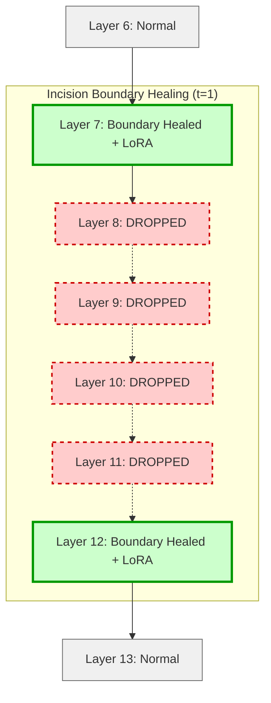

# Incision Boundary Healing: Causal Sensitivity Oracles for Surgical LoRA Recovery of Pruned LLMs

**Status**: COLM 2026 Submission Ready ✓  
**Evaluated Models**: Mistral-7B, Meta-Llama-3-8B, Gemma-2-2B

---

## 🎯 Project Overview

This repository contains the code, experiments, and LaTeX source for our COLM 2026 submission. We demonstrate that structural depth pruning (layer dropping) in Large Language Models induces highly localized representation shifts rather than global network degradation.

We introduce **Incision Boundary Healing**, a targeted LoRA routing strategy that restricts trainable parameters exclusively to the boundary layers immediately adjacent to the dropped block.



### 🏆 Key Discoveries
1. **The Bathtub Curve of Layer Sensitivity**: Pruning damage is asymmetrical. Early and late layers are highly sensitive, while middle layers are elastic.
2. **Surgical PEFT Allocation**: Targeting capacity only where the model's structural integrity has been compromised prevents "Dense Noise Pollution".
3. **Cross-Architecture Validation**: 
   - **Global Attention (Mistral/Llama-3)**: Semantic bleed is tightly localized. A hard recovery plateau is reached at a boundary thickness of $t=2$.
   - **Sliding Window Attention (Gemma-2)**: Interrupted SWA expansion causes wider bleed, resulting in a smooth monotonic decay curve that benefits from wider boundary thickness ($t=3$).

---

## 📁 Codebase Organization

*   `paper/`: Contains the final `main.tex` and compiled figures for the COLM submission.
*   `code/phases/phase15_layer_drop/`: Contains the pipeline scripts for dropping layers, measuring baseline/dropped perplexities on C4, and applying boundary healing.
*   `experiments/phase15_layer_drop/`: Contains the raw JSON outputs and loss curves for all evaluated models.
*   `scratch/extract.py`: Automated script for extracting LaTeX tables from the JSON results.
*   `archive/`: Contains legacy experiments on GPT-2 (Phases 1-11).

---

## 🚀 Quick Start (Reproduce Results)

The entire multi-architecture ablation pipeline is fully automated and designed to run on a single dual-GPU node (e.g., 2x RTX 3090).

```bash
# Run Mistral-7B Evaluation
./code/phases/phase15_layer_drop/run_phase15.sh

# Run Llama-3-8B Evaluation
./code/phases/phase15_layer_drop/run_phase16c_llama.sh

# Run Gemma-2-2B Evaluation
./code/phases/phase15_layer_drop/run_gemma_pipeline.sh

# Generate Final LaTeX Tables
python scratch/extract.py
```

## 🛠️ Reproducibility (Minimal Proof of Concept)

For workshop reviewers, we provide a standalone, highly readable (< 100 lines) reproducible script that drops layers, routes a boundary LoRA, and executes a training loop on a snippet of the C4 dataset. 

```bash
python runners/reproduce_ablation.py
```

---
*Created for COLM 2026 (Double-Blind Review)*
