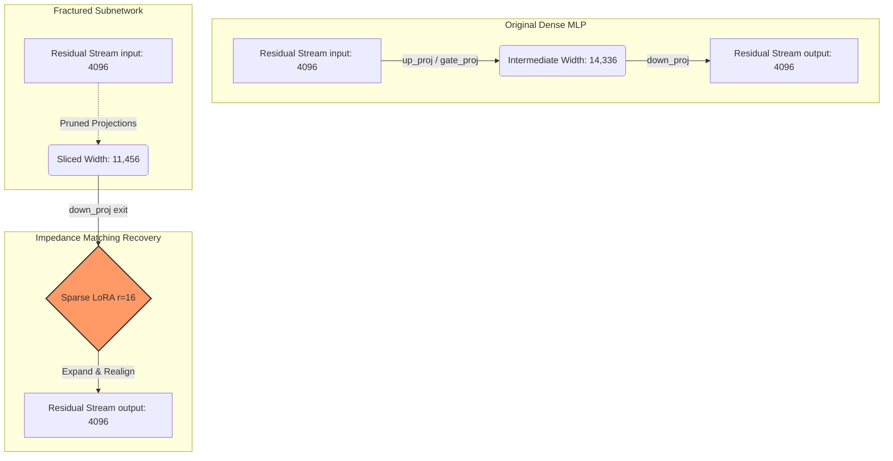

# TIM-MGDT: The Cognitive Retention Threshold and Hardware-Aware Subnetwork Pruning

**Status**: Active Pipeline (Hardware-Aligned Boundary Ablation)  
**Evaluated Models**: Meta-Llama-3-8B

---

## 🎯 Project Overview & Architectural Pivot

This repository documents a fundamental architectural pivot in our LLM compression thesis. 

Our earlier experiments (Phase 15) successfully demonstrated that **Incision Boundary Healing**—targeting LoRA adapters exclusively to the layers adjacent to a dropped block—could rapidly recover the baseline validation loss and perplexity on generic pre-training distributions.

However, rigorous zero-shot evaluation on downstream logic benchmarks (GSM8K, MMLU, ASDiv) yielded a stark **Semantic vs. Sequential Divergence**:

> ⚠️ **The Perplexity Trap (Phase 15 Negative Result):** Recovering a validation loss curve does not equate to recovering a model's cognitive core. Macroscopic depth-pruning (dropping Layers 14-17) resulted in a $0\%$ recovery rate on structured reasoning tasks like GSM8K. Depth is a mandatory prerequisite for sequential logic. 

We have officially pivoted the methodology to **Microscopic Subnetwork Width Pruning**. By excising 20% of the network's width instead of its depth, we successfully preserved the topological integrity of the reasoning pathways, retaining **80.3% of GSM8K capability**.

---

## 🏎️ Hardware Alignment & The Memory Wall

While unconstrained Empirical FIM calibration successfully identifies redundant subnetwork paths, our pareto diagnostics revealed a paradox: an unconstrained 20.06% FLOP reduction yielded a **0.00% physical speedup** (`39.94 t/s` vs `40.08 t/s` baseline).

### The "Death by 78 Cuts"
During the autoregressive decoding phase, operations are memory-bandwidth bound. Modern NVIDIA Tensor Cores utilize structured matrix tiles ($16\times16$, $32\times32$, or $64\times64$) to optimize memory coalescing. 

When an unconstrained FIM mask slices an MLP intermediate dimension from $14,336$ to an unaligned integer like $11,469$, $11,469 \pmod{64} \neq 0$. This forces the GPU to either dynamically pad the tensor with zero-elements in-flight or fall back to legacy kernels.

To resolve this, our automated pipeline now enforces strict **Tile-Aligned constraints** (`ceil` or `floor` bounding) to ensure $\mathcal{B} \in \{16, 32, 64\}$ boundaries are respected, reclaiming physical latency without sacrificing logical topology.

---

## 🌉 Residual Stream Impedance Matching

Slicing internal MLP and GQA dimensions creates an immediate dimensional mismatch when those subnetworks attempt to add their outputs back to the $4,096$-dimension residual stream. 

To counteract this, we restrict our Sparse LoRA ($r=16$) adapters exclusively to the exit layers (`o_proj` and `down_proj`) of the 6 most FIM-damaged layers.

### ⚠️ Critical Note on Custom Tensor Loaders
Standard HuggingFace `from_pretrained` homogeneous initialization will crash on asymmetrically pruned network weights. Our execution pipeline bypasses this by utilizing a custom `safetensors` loader that dynamically resizes the `nn.Linear` modules prior to loading the fractured weight distribution.

---

## 📊 Comparative Recovery Metrics

The table below contrasts the catastrophic reasoning failure of Phase 15 Layer-Dropping against the cognitive retention of Phase 16 Subnetwork Pruning.

| Model Pipeline | Theoretical MAC Red. | Native PyTorch TPS | MMLU | GSM8K |
|---|---|---|---|---|
| Meta-Llama-3-8B (Dense Base) | - | 40.08 t/s | 65.5% | 50.5% |
| Layer-Dropped (Phase 15) | -15.84% | +21.4% | 31.5% | 0.9% |
| Unconstrained Pruning (Phase 16) | -20.06% | +0.00% (39.94 t/s) | 64.1% | 40.5% |
| **Tile-Aligned `ceil` (Phase 16)** | *Pending* | *Pending* | *Pending* | *Pending Ablation* |
| **Tile-Aligned `floor` (Phase 16)**| *Pending* | *Pending* | *Pending* | *Pending Ablation* |

---

## 📁 Codebase Organization & Execution Pipeline

The infrastructure is designed for multi-GPU execution. The primary automation suite is actively running the boundary ablation study:

*   `paper/`: Contains the LaTeX source documenting the pivot to the Depth-Width Trade-off thesis.
*   `scratch/fim_variant_analysis.py`: The robust Empirical FIM calibration pipeline.
*   `scratch/prune_subnetworks_aligned.py`: Hardware-constrainedPyTorch surgery script (`ceil`/`floor` boundaries).
*   `scratch/sparse_lora_heal.py`: Custom dynamic loader and PEFT healing configuration for Impedance Matching.
*   `scratch/evaluate_healed.py`: Wraps the asymmetric tensors in `lm_eval` HFLM for downstream verification.
*   `scratch/run_ablation.sh`: Master background loop executing the comparative FIM structural alignments.

---
*Created for COLM 2026 (Double-Blind Review)*
