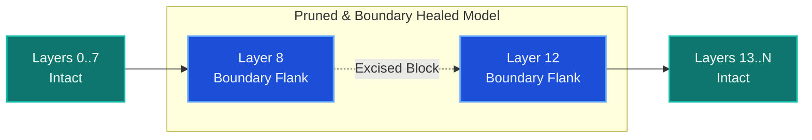

# The Fluency–Reasoning Dissociation in Depth-Pruned LLMs: A Representational Geometry Perspective

[-blue.svg)](https://neurreps.org/)
[](https://creativecommons.org/licenses/by/4.0/)
[](https://github.com/SakshamKapoor2911/tim-mgdt)

Official research repository and replication code for **"The Fluency–Reasoning Dissociation in Depth-Pruned LLMs: A Representational Geometry Perspective"**, accepted for publication at the **NeurIPS 2026 Workshop on Symmetry and Geometry in Neural Representations (NeurReps, PMLR Track)**.

---

## 🎯 Abstract & Key Findings

Contiguous depth pruning reduces memory and latency in Large Language Models (LLMs) by removing intermediate layers, but severs residual stream continuity at the incision interface. While parameter adaptation can restore surface language modeling fluency, multi-step reasoning accuracy collapses catastrophically.



### Key Scientific Contributions

1. **Incision Boundary Healing**: Confinements of LoRA parameter adaptation exclusively to the $t$ layers directly flanking the incision boundary ($t=2$ for Mistral-7B and Llama-3-8B; $t=3$ for Gemma-2-2B). On standard global-attention architectures, boundary healing improves C4 perplexity by 0.608–1.534 points over 6-layer global sensitivity LoRA while updating **33.3% fewer parameters**.
2. **The Fluency–Reasoning Dissociation**: While text perplexity recovers to near-dense levels (9.12 vs. 7.86 on C4), multi-step reasoning on GSM8K collapses from **39.6% to 1.8%** and recovers to only **6.2%** ($N=500$, 8-shot CoT). On Big-Bench Hard Multi-Step Arithmetic, accuracy drops to $\le 1\%$ across all drop depths.
3. **Canonical Subspace Rotation**: Representation geometry ($N=50$ passages) reveals depth pruning induces a **$33.93^\circ$–$45.60^\circ$ canonical subspace rotation** across model families, which parameter adaptation only partially realigns ($\Delta\theta = -1.90^\circ \pm 0.32^\circ$).
4. **Causal Sufficiency via Inverse Procrustes**: In an intact model with **zero layers removed and zero weights modified**, applying the pruning-derived inverse Orthogonal Procrustes transformation $(R^*)^T$ reproduces the reasoning collapse ($39.6\% \to 9.0\%$, $p = 5.6 \times 10^{-35}$), while magnitude-matched planar controls ($40.3\%$) leave reasoning intact and random $\mathrm{SO}(d)$ placebos collapse to $0.0\%$.

---

## 📊 Summary of Main Results

### 1. C4 Perplexity vs. GSM8K Multi-Step Reasoning ($N=500$, 8-shot CoT)

| Condition | Updates (Params) | C4 PPL ($\downarrow$) | GSM8K Acc. ($\uparrow$) | 95% Clopper-Pearson CI |
| :--- | :---: | :---: | :---: | :---: |
| **Dense Baseline (Mistral-7B)** | — | **7.86** | **39.6%** | [35.3%, 44.0%] |
| **4-Layer Drop (Unhealed)** | 0% | 15.34 | 1.8% | [0.8%, 3.4%] |
| **Global Sensitivity LoRA (6 layers)** | 62.9M (100%) | 10.65 | 4.0% | [2.5%, 6.1%] |
| **Incision Boundary Healing ($t=2$)** | **41.9M (-33.3%)** | **9.12** | **6.2%** | [4.3%, 8.7%] |

### 2. Causal Sufficiency Intervention (Intact Mistral-7B, Zero Weights Changed)

| Hook Intervention at Layer 15 | GSM8K Accuracy | $\Delta$ vs. Dense | Statistical Significance |
| :--- | :---: | :---: | :--- |
| **Intact Baseline** | **39.6%** | — | Baseline |
| **Artificial $(R^*)^T$ Procrustes Hook** | **9.0%** | **-30.6 pp** | $p = 5.6 \times 10^{-35}$ (Exact McNemar) |
| **Matched-Angle Planar Control ($\theta=34.02^\circ$)** | **40.3%** | **+0.7 pp** | $p = 0.36$ (Fisher combined, 3 seeds) |
| **Random $\mathrm{SO}(d)$ Haar Placebo** | **0.0%** | **-39.6 pp** | $p < 10^{-45}$ |

---

## 📁 Repository Structure

```
.
├── paper/                          # Camera-ready manuscript sources
│   ├── main.tex                    # PMLR camera-ready LaTeX source
│   ├── references.bib              # Verified bibliography
│   ├── jmlr.cls                    # Official NeurReps 2026 class file
│   └── figures/                    # Vector PDF and PNG plots
├── runners/                        # Entrypoint reproduction scripts
│   ├── reproduce_ablation.py       # Minimal boundary healing & perplexity check
│   └── run_causal_procrustes.py    # Causal hook evaluation runner
├── code/
│   ├── phases/
│   │   ├── phase15_layer_drop/     # Pruning and boundary healing pipelines
│   │   ├── phase17_mechanistic/    # Attention heatmaps and cosine similarities
│   │   └── phase25_causal/         # SVD, Procrustes calculation, and planar rotations
│   └── evaluation/                 # GSM8K 8-shot CoT evaluation harness
└── experiments/                    # Stored raw JSON execution logs and metrics
```

---

## 🚀 Quick Start & Reproducibility

### 1. Environment Setup

```bash
git clone https://github.com/SakshamKapoor2911/tim-mgdt.git
cd tim-mgdt

python -m venv .venv
source .venv/bin/activate  # On Windows: .venv\Scripts\activate
pip install -r requirements.txt
```

### 2. Minimal Boundary Healing Run (< 100 lines)

To drop layers 8–11 from Mistral-7B, instantiate the boundary adapters, and test perplexity on C4:

```bash
python runners/reproduce_ablation.py --model mistralai/Mistral-7B-v0.1 --drop_start 8 --drop_end 11 --thickness 2
```

### 3. Causal Procrustes Intervention Test

To apply the inverse Orthogonal Procrustes hook onto the intact model residual stream without weight changes:

```bash
python code/phases/phase25_causal/run_procrustes_hook.py \
    --model_id mistralai/Mistral-7B-v0.1 \
    --layer_idx 15 \
    --dataset gsm8k \
    --num_samples 500
```

---

## 📜 Citation

If you find this work, data, or experimental harness useful in your research, please cite:

```bibtex
@InProceedings{kapoor26,
  title     = {The Fluency--Reasoning Dissociation in Depth-Pruned {LLM}s: A Representational Geometry Perspective},
  author    = {Kapoor, Saksham},
  booktitle = {Proceedings of the NeurIPS 2026 Workshop on Symmetry and Geometry in Neural Representations},
  year      = {2026},
  series    = {Proceedings of Machine Learning Research},
  publisher = {PMLR},
  abstract  = {Contiguous depth pruning reduces memory and latency in large language models by removing intermediate layers, but severs residual stream continuity at the incision interface. Standard recovery fine-tunes all remaining layers with LoRA, indiscriminately perturbing parameters in distant, unaffected blocks. We study post-pruning recovery through a controlled experimental vehicle, Incision Boundary Healing, which confines parameter adaptation to the $t$ layers directly flanking the cut. On standard global-attention architectures (Mistral-7B-v0.1, Meta-Llama-3-8B), boundary healing ($t=2$) improves C4 perplexity by 0.608--1.534 points over 6-layer global sensitivity LoRA while updating 33.3\% fewer parameters; Gemma-2-2B needs $t=3$ (sliding-window attention), with no parameter savings. However, restoring language modeling fluency exposes a severe fluency--reasoning dissociation: while text perplexity returns to near-dense levels (9.12 vs. 7.86 on C4), multi-step reasoning accuracy on GSM8K collapses from 39.6\% to 1.8\% and recovers to only 6.2\% ($N=500$, 8-shot CoT). On Big-Bench Hard Multi-Step Arithmetic, reasoning accuracy drops to $\le 1\%$ across all pruning depths. Representation geometry ($N=50$ sequences) reveals that depth pruning induces a $33.93^\circ$--$45.60^\circ$ canonical subspace rotation across model families, which boundary healing only partially realigns ($\Delta\theta = -1.90^\circ \pm 0.32^\circ$). In global-attention models, $\mathrm{PC}_1$ preserves its orientation ($\le 0.75^\circ$ deviation) but undergoes architecture-dependent variance collapse, compressing the primary reasoning subspace. In an intact model with zero weights modified, applying the pruning-derived inverse Procrustes rotation $(R^*)^T$ reproduces the reasoning collapse ($39.6\% \to 9.0\%$, $p = 5.6 \times 10^{-35}$), whereas magnitude-matched planar rotations leave accuracy intact ($40.3\%$) and random $\text{SO}(d)$ rotations destroy it indiscriminately ($0.0\%$), confirming selective vulnerability to the pruning-derived transformation. These findings establish that post-pruning reasoning failure is caused by coordinated subspace misalignment rather than scalar drift or capacity limits.},
  software  = {https://github.com/SakshamKapoor2911/tim-mgdt}
}
```

---

## 🤝 Acknowledgments

We thank the mentors and community at **Algoverse** for valuable discussions throughout this research, and **Startup Shell** for providing access to the dual-RTX 3090 GPU cluster that executed all training runs, geometric measurements, and causal interventions.
